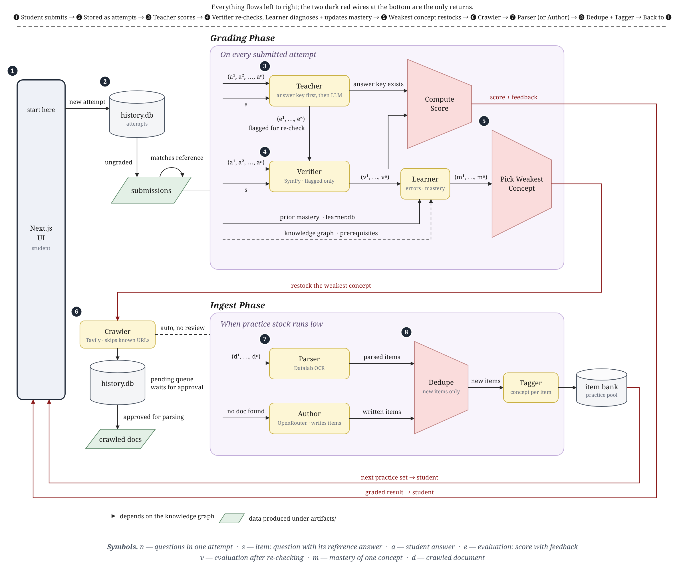

<div align="center">
  
  <h1>MASTER THPT</h1>
</div>

<p align="center">
  <b>A multi-agent maths tutor for Vietnamese high school.</b> Seven roles — five of them LLM-driven,
  the rest a search crawler and an OCR parser — crawl for exam papers, turn them into questions, grade
  what the student submits, re-check the grading no answer key can settle, diagnose what went wrong,
  and restock practice for whatever the learner is weakest at — on a 701-concept knowledge graph.
</p>

<p align="center">
  
  
  
  
  
  
</p>

## Preview

https://github.com/user-attachments/assets/f50e78b4-eca2-4271-9ea7-0de16cf6b9bf

## Overview and Core Value Proposition

Vietnamese students preparing for the national maths exam do not lack exercises — they lack
exercises aimed at the exact thing they get wrong. MASTER THPT closes that loop end to end. Every
submitted answer is graded, re-checked when no answer key can settle it, classified by error type,
and turned into a mastery number for the concepts it touches on the curriculum graph; the weakest
concept immediately becomes the system's next crawl target. The practice stock is a consequence of
the learner's own mistakes rather than a fixed syllabus.

On top of that loop sits a daily habit: a placement test that seeds a grade 12 learning path, a
stage map of stations to clear, a spaced-repetition review set every day, streaks and XP.

The whole system runs as two Python pipelines plus a Next.js front end. There is no orchestrator
service and no message broker: grading fans out over one attempt's questions, and restocking runs in
a background thread as soon as grading names a weak concept.

## Key Features

- **Answer key before any model call.** An answer that matches the reference key is marked by
  `match_answer` alone — no teacher call, no verifier call, no cost.
- **Self-checking where it buys something.** A multiple-choice or true/false item that has a key is
  already settled. Evaluations no key can settle are flagged and re-run by the verifier, which has
  SymPy on hand to decide algebraic equivalence.
- **Error diagnosis.** Every wrong answer is classified by the learner (wrong formula, missed
  condition, algebra slip, misread question, …) with a confidence score; recurring errors surface in
  the daily review as the reason a question was picked.
- **Placement test and learning path.** A short placement test (playable as a guest, before
  signing up) places the learner on a grade 12 stage map built from the textbook chapters. Each
  station is cleared at `STATION_PASS_RATE`; obstacles and skip tests guard the jumps.
- **Spaced repetition.** Daily reviews are scheduled with FSRS and capped by `REVIEW_DAILY_LIMIT`.
  Cards are not stored: they are replayed from the answer history on every request.
- **Practice that restocks itself.** Weak concept in, Tavily search out; new papers are OCR'd,
  deduplicated against the item bank, and tagged against the knowledge graph. If nothing is found
  online, the author writes the missing questions.
- **Approval gate for ingest.** In manual mode crawled URLs queue up in the exam bank and wait for a
  human to approve them before anything is parsed.
- **Hints while working, solutions after grading.** Staged hints are streamed during an attempt; the
  full worked solution unlocks only once the answer has been marked.
- **Free and Pro plans.** Accounts and billing go through Clerk. Pro unlocks the per-question tutor
  chat and on-demand practice for any topic.

## Screens

| Route | Screen |
| --- | --- |
| `/onboarding` | Landing, guest placement test, sign-up prompt. |
| `/today` | Daily goal, streak, the review set due today and the focus concept. |
| `/learning_path` | Grade 12 stage map: stations, obstacles, chests, placement reset. |
| `/documents` | Exam bank, filterable by grade and attempt status; crawl queue approval. |
| `/practice` | The day's spaced-repetition review. |
| `/exams/[id]` | Sitting an exam or practice set, with hints and the tutor chat. |
| `/history`, `/history/[id]` | Attempt timeline; one graded attempt with per-option marking and solutions. |
| `/profile` | Profile, study settings, plan, learning-path reset. |

## How one attempt travels through the system



The figure is generated from [`assets/workflow.html`](assets/workflow.html) — open it in a browser
for the vector version.

Two pipelines, and they only touch through the item bank and the learner's mastery table:

**Grading.** `grade()` runs the teacher, the verifier and the learner in that order. The teacher
tries the answer key first (`match_answer`): an answer that matches it is marked with no LLM call
at all. Otherwise the teacher grades with a model and `settled()` decides what follows. A
multiple-choice or true/false item that has a key is settled; everything else is flagged. The
verifier re-checks *only* the flagged ones, with SymPy available as a tool for algebraic
equivalence. Short answers are deliberately never settled: `1/2`, `0.5` and `0,5` are the same
number, and string comparison cannot say so. A verifier verdict on a wrong answer is cached back
into the item bank as that item's solution. The learner diagnoses each wrong answer, writes one
mastery update per concept mapped to each graded question, then picks the weakest concept touched
by the attempt and kicks off restocking in a background thread. A guest placement test, submitted
after sign-up, skips the models entirely when every item has a key (`grade_by_key`).

**Ingest.** Restocking asks the crawler for material on that concept. Tavily searches, already-known
URLs are skipped. Found documents go through Datalab OCR in the parser; if nothing is found at all
the author writes the missing questions instead. Either way the result is deduplicated against
`item_bank.jsonl` by fingerprint, and only genuinely new items are sent to the tagger — so
re-ingesting a document costs no LLM calls. The tagger maps each item to one to
`TAGGER_MAX_TAGS` knowledge nodes, in batches of `TAGGER_BATCH_SIZE`.

## Roles

| Role | Code | Decided by | What it does |
| --- | --- | --- | --- |
| **Teacher** | `backend/roles/teacher` | LLM | Answer key first, LLM evaluation second; also streams hints, solutions and the tutor chat. |
| **Verifier** | `backend/roles/verifier` | LLM + SymPy | Re-checks flagged evaluations only, with SymPy tools. |
| **Learner** | `backend/roles/learner` | LLM + arithmetic | Error diagnosis via TypeSafe on OpenRouter; mastery, FSRS reviews, learning path and weakest-concept selection are deterministic. |
| **Author** | `backend/roles/author` | LLM | Writes items from scratch when the crawler comes back empty, or on a Pro topic request. |
| **Tagger** | `backend/roles/tagger` | LLM | Maps each new item to its knowledge nodes. |
| **Crawler** | `backend/roles/crawler` | Tavily API | Search + fetch for a concept, excluding URLs already in the bank. |
| **Parser** | `backend/roles/parser` | Datalab OCR | PDF/Word → OCR → one `refined.json` per document. |

Each role reads its model from `OPENROUTER_<ROLE>_MODEL`. Grading fans out across questions with a
thread pool (`MAX_GRADING_WORKERS`), and every LLM call is traced to LangSmith.

## Data stores

| Store | Kind | Contents |
| --- | --- | --- |
| `artifacts/history/history.db` | SQLite (WAL) | `account_profile` (profile and settings as JSON), `history` (attempts), `history_question` (answers, scores, feedback, error type, grading trace) and `crawl_queue` (URLs waiting for approval). |
| `artifacts/learner/learner.db` | SQLite (WAL) | `knowledge_state` (mastery and attempt counts per user, concept and question type), `question_knowledge` (item → concept) and `error_state` (diagnosed error counts). |
| `artifacts/item_bank.jsonl` | JSONL | The practice pool, deduplicated by fingerprint. New items are appended; cached solutions are written back under a file lock. |
| `artifacts/data/<document>/` | JSON + images | `raw.json`, `refined.json` and extracted images per source document, served at `/api/images`. |
| `artifacts/knowledge_graph/` | JSON + CSV | `knowledge_graph.json` (701 concepts, 808 edges), the per-stage build caches and the Neo4j import CSVs. |
| Clerk | Hosted | Users, sign-in, passwords and Pro subscriptions. The backend only sees the user id and plan from the JWT. |
| Browser `localStorage` | Client | A guest's placement answers until sign-up, and which streak milestones were already shown. |
| `frontend/public/guest/` | Static JSON | Pre-built placement exams for guests, written by `scripts/guest_exams.py`. |
| Neo4j Aura | Optional | Not used at runtime; `knowledge.graph.convert` only exports CSVs for importing the graph there. |

## Knowledge graph

701 concepts (250 in grade 10, 308 in grade 11, 143 in grade 12) and 808 edges: 562 `REQUIRES`,
157 `IS_A`, 76 `PART_OF`, 13 `SUBSET_OF`.

It is built offline from the textbook PDFs in `artifacts/textbooks/raw`, not at startup. Each stage
caches into `artifacts/knowledge_graph/` so a rerun only pays for what changed:

```bash
cd backend
python -m knowledge.graph.refine        # PDF -> Datalab OCR -> refined Markdown
python -m knowledge.graph.chunk         # split into lessons
python -m knowledge.graph.extract       # lesson -> concepts + local edges
python -m knowledge.graph.canonicalize  # merge duplicate concepts across books
python -m knowledge.graph.link          # global prerequisite edges, cycle resolution
python -m knowledge.graph.convert       # knowledge_graph.json + CSVs for an optional Neo4j import
python -m scripts.validate_graph
```

The app reads `knowledge_graph.json` directly for node lists, prerequisite traversal and the
learning path.

## API

FastAPI, everything under `/api`, every route behind a Clerk bearer token. Routes marked Pro
return `402` on the free plan.

| Route | Purpose |
| --- | --- |
| `GET/PATCH /api/me` | Account: profile, settings, XP, streak, plan. |
| `GET /api/documents`, `GET /api/documents/{id}` | Exam bank and one exam's items. |
| `GET/DELETE /api/ingest`, `POST /api/ingest/mode`, `POST /api/ingest/approve` | The manual crawl queue: inspect, switch auto/manual, drop or approve a URL. |
| `GET /api/quest`, `GET /api/quest/{id}`, `POST /api/quest/start`, `POST /api/quest/reset` | Learning path, one station/obstacle test, start or reset the path. |
| `GET /api/review` | Today's FSRS review set and its focus concept. |
| `GET /api/practice/sets`, `GET /api/practice/status`, `POST /api/practice/update` (Pro) | Practice sets, background stocking progress, request a topic. |
| `POST /api/exams/submit`, `GET /api/exams/grading-status` | Submit an attempt, poll grading. |
| `POST /api/practice/check-question` | Grade a single practice question. |
| `POST /api/hints`, `POST /api/solutions`, `POST /api/teacher/chat` (Pro) | Streamed (SSE) hints, worked solutions and tutor chat. |
| `POST /api/history`, `GET /api/history`, `GET /api/history/{id}` | Attempt history. |
| `GET /api/knowledge_graph` | The graph overlaid with the learner's mastery. |

## Local development

Two processes: FastAPI on port 8000 and Next.js on port 3000. The browser only ever talks to port
3000 — Next.js rewrites `/api/*` to `API_PROXY_TARGET`.

1. **Environment:**
```bash
cp .env.example .env
cp frontend/.env.example frontend/.env.local
```
Fill `.env` with your Tavily, Datalab, OpenRouter, LangSmith and Clerk JWKS settings. Every tuning
knob lives there too — crawler limits, grading concurrency, mastery rates and thresholds, review and
learning-path sizes. Fill `frontend/.env.local` with the Clerk keys and the Pro plan id; set
`MOCK_ACCOUNT=True` to run the UI without signing in.

2. **Backend:**
```bash
cd backend
uv venv
uv pip install -r requirements.txt
.venv/bin/python -m api.router
```

3. **Frontend:**
```bash
cd frontend
npm install
npm run dev
```

4. **Tests:**
```bash
(cd backend && .venv/bin/python -m pytest -q)
(cd frontend && npm run typecheck)
```

## Deployment

`backend/docker-compose.yml` runs the API behind Caddy, which serves HTTPS for `DOMAIN` from
`.env`. `artifacts/` is mounted as a volume so the databases and item bank survive rebuilds.

```bash
cd backend
docker compose up -d --build
```

The frontend deploys as a regular Next.js app with `API_PROXY_TARGET` pointed at that domain.

## Tech stack

| Layer | Technology |
| --- | --- |
| **Frontend** | Next.js 14 App Router, React 18, TypeScript, Clerk, KaTeX, Rive |
| **Backend** | Python, FastAPI, Uvicorn, Pydantic, `fastapi-clerk-auth` |
| **Roles** | OpenRouter (per-role models), TypeSafe, LangSmith tracing, SymPy, Tavily, Datalab OCR, FSRS |
| **Storage** | SQLite (`history.db`, `learner.db`), JSONL item bank, JSON documents and knowledge graph, Clerk (users and billing), browser `localStorage`, Neo4j Aura (optional export) |
| **Deploy** | Docker, Caddy |

## Repository layout

```
.
├── backend/                                # FastAPI service, port 8000
│   ├── main.py                             # grade(), ingest(), stock_practice(), approve()
│   ├── api/                                # every /api route, schemas, account
│   ├── roles/
│   │   ├── teacher/                        # answer key first, then LLM; hints, solutions, chat
│   │   ├── verifier/                       # re-checks flagged evaluations with SymPy
│   │   ├── learner/                        # error diagnosis, mastery, FSRS, learning path
│   │   ├── author/                         # writes items when the crawler finds nothing
│   │   ├── tagger/                         # item -> knowledge nodes
│   │   ├── crawler/                        # Tavily search, skips known URLs
│   │   └── parser/                         # Datalab OCR, then split into items
│   ├── knowledge/
│   │   ├── bank/                           # dedupe, append, item lookup
│   │   └── graph/                          # offline graph build and prerequisite queries
│   ├── history/                            # accounts, attempts and the crawl queue
│   ├── common/                             # shared schemas, LLM and JSON helpers
│   ├── scripts/                            # graph validation, stats, guest exams
│   ├── tests/                              # pytest
│   ├── Dockerfile, docker-compose.yml, Caddyfile
│   └── requirements.txt
├── frontend/                               # Next.js 14, port 3000
│   ├── app/
│   │   ├── (common)/                       # today, learning_path, documents, practice,
│   │   │                                   # exams/[id], history, profile
│   │   ├── onboarding/                     # landing and guest placement test
│   │   └── sign-in/, sign-up/              # Clerk
│   ├── components/                         # sidebar, rail, plans, Rive, providers
│   ├── features/exams/                     # exam room, tutor chat, math rendering
│   ├── lib/                                # quest, history and processing helpers
│   ├── shared/api/                         # api client, mock account
│   ├── public/                             # favicon, Rive files, guest exams, preview.mp4
│   └── middleware.ts                       # Clerk route guard
├── artifacts/
│   ├── data/                               # raw.json, refined.json, images per document
│   ├── textbooks/                          # raw and refined Markdown
│   ├── knowledge_graph/                    # stage caches, knowledge_graph.json, neo4j CSVs
│   ├── history/                            # history.db
│   ├── learner/                            # learner.db
│   └── item_bank.jsonl                     # the practice pool
├── assets/                                 # workflow.png and workflow.html
├── .env.example                            # keys and tuning knobs
└── README.md
```

## License

MIT, covering the code in this repository. Exam papers, textbook extracts and anything else under
`artifacts/` stay with their original owners and are not licensed here.
